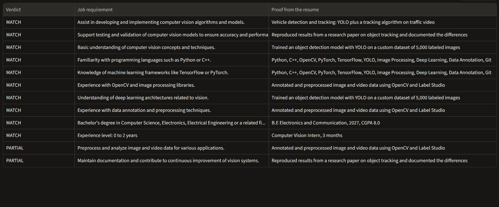
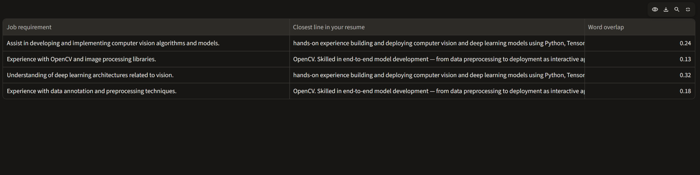

# Resume - JD Matcher

Ranks resumes against a job description and shows the resume lines that back up each match.

**Live demo:** https://jd-resume-matcher.streamlit.app/




## What it does
- Pick one of 10 job descriptions and see 10 sample resumes ranked for it.
- See which job requirements a resume matches, with the exact resume line as proof, and which it does not.
- Upload your own resume (PDF or text) to see where it would rank, with the closest resume line for each requirement.

## Results
I compared scoring methods on 10 job descriptions x 10 resumes, using 100 hand-reviewed labels (0 = no fit, 1 = some fit, 2 = strong fit).

| Method | Top-1 | Top-2 | Top-3 | Mean NDCG@3 |
|---|---|---|---|---|
| TF-IDF (word matching) | 8 of 10 | 10 of 10 | 10 of 10 | 0.90 |
| Sentence embeddings (MiniLM) | 6 of 10 | 9 of 10 | 10 of 10 | 0.88 |
| Embeddings with 80-word chunks | 7 of 10 | 8 of 10 | 9 of 10 | 0.87 |
| Hybrid: TF-IDF + plain embeddings | 6 of 10 | 10 of 10 | 10 of 10 | 0.88 |
| **Hybrid: TF-IDF + chunked embeddings** | 7 of 10 | 10 of 10 | 10 of 10 | **0.91** |

Top-k means the best resume for a job was in the first k places. NDCG@3 measures how close the top 3 are to the ideal order (1.0 is perfect).

## What I found
- A simple word-matching baseline was hard to beat. Embeddings did not clearly win on this test.
- The methods fail on different jobs, so averaging them gave the best overall ranking quality (NDCG 0.91) and kept the best resume in the top 2 for every job. The best top-1 score still belongs to TF-IDF alone.
- My real resume is 460 words and the synthetic ones are about 125. It ranked high in most methods, probably because of its length and style. Long text gives every method more chances to match.
- A strict score cutoff cannot separate "mentions the topic" from "proves the skill". Letting an AI model judge only a few candidate lines per requirement fixed several false matches and false gaps.

## How it works
1. Score every resume against every job with TF-IDF and with sentence embeddings (the resume is split into chunks).
2. Rescale each method to 0-1 per job and average the two, which gives the ranking.
3. For each job requirement, find the 3 most similar resume lines.
4. An AI model (a free OpenRouter model) labels each requirement MATCH, PARTIAL or GAP and copies the supporting line.
5. A check accepts a quote only if it matches a real resume line, so the proof shown is always genuine resume text.
6. Explanations were generated once and saved (16 explanations: the top 2 resumes for 8 jobs), so the live app needs no API key.

## Limits
- Small test: 10 jobs and 10 resumes. One job flipping changes top-1 by 10 points, so small gaps between methods are not reliable.
- 9 of the 10 resumes are synthetic, written with AI help, and they reuse the jobs' keywords, which favors word matching. The labels were drafted with AI help and reviewed and corrected by me.
- The match judgments come from an AI model and can be wrong. The check guarantees the quoted line exists, not that the judgment is right.
- Uploaded resumes are compared by word matching only, which favors long resumes and misses synonyms. Scanned PDFs (photos of a page) cannot be read.
- Job descriptions jd_03 and jd_10 have no saved explanations yet.

## Privacy
Uploaded files are not stored and are not sent to any AI service. The upload feature uses word matching only.

## Run it locally
```bash
pip install -r requirements.txt
python -m streamlit run app.py
```
To recompute scores or explanations you also need `sentence-transformers` and, for explanations, an OpenRouter key in a `.env` file (never commit this file).

## Project structure
- `app.py` - the web app
- `src/` - scoring, evaluation, line matching and explanation code
- `data/` - job descriptions, resumes, labels, saved scores and explanations
- `RESULTS.md` - the full comparison table and notes
- `LOG.md` - daily project log

## Tools
Python, scikit-learn, sentence-transformers, pandas, Streamlit, pdfplumber, OpenRouter.
